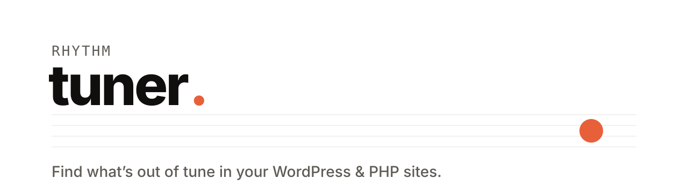
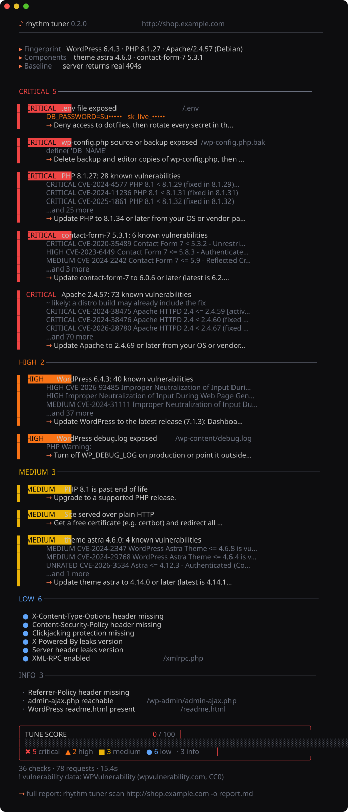

<p align="center">
  <picture>
    <source media="(prefers-color-scheme: dark)" srcset="docs/assets/banner-dark.svg">
    
  </picture>
</p>

<p align="center">
  <b>A fast, open-source security scanner for WordPress &amp; PHP sites.</b><br>
  Leaked secrets · exposed files · known CVEs · weak configuration. One binary, no API key, no limits.
</p>

<p align="center">
  <a href="https://github.com/RhythmShahriar/tuner/releases/latest"></a>
  <a href="https://github.com/RhythmShahriar/tuner/actions/workflows/ci.yml"></a>
  <a href="LICENSE"></a>
  <a href="go.mod"></a>
</p>

<p align="center">
  <a href="#install">Install</a> ·
  <a href="#scan">Scan</a> ·
  <a href="#what-it-finds">What it finds</a> ·
  <a href="https://github.com/RhythmShahriar/rhythm/wiki/Tuner">Docs</a> ·
  <a href="https://github.com/RhythmShahriar/rhythm/wiki/Tuner-CI">CI</a> ·
  <a href="https://github.com/RhythmShahriar/rhythm/wiki/Tuner-Writing-Checks">Write a check</a>
</p>

<br>

<p align="center">
  
</p>

<br>

## The Rhythm set

| | Asks | Checks |
|---|---|---|
| **Tuner** | **Is my site safe?** | **what an attacker can find** |
| [Soundcheck](https://github.com/RhythmShahriar/soundcheck) | Did my change break anything? | what visitors see and do |
| [Echo](https://github.com/RhythmShahriar/echo) | Is my site still saying what it should? | everything the site sends |

## Install

**macOS · Linux**

```sh
curl -fsSL https://rythm.sh/install | sh
```

**Windows** (PowerShell)

```powershell
irm https://rythm.sh/install.ps1 | iex
```

**Go**

```sh
go install github.com/RhythmShahriar/tuner/cmd/rhythm-tuner@latest
```

Installed with Go? You have the `rhythm-tuner` binary without the `rhythm` CLI, so run `rhythm-tuner scan yoursite.com` wherever this page says `rhythm tuner scan`. Help and hints use the name you started Tuner with.

The installers and `rhythm update` check every download against the release's `checksums.txt`. That file comes from the same release, so it catches a broken download, not a tampered release. Releases are also signed with cosign. Nothing checks the signature for you yet, so [verify a release by hand](https://github.com/RhythmShahriar/rhythm#verify-a-release) if that matters to you. Prefer a manual install? Grab a binary from [Releases](https://github.com/RhythmShahriar/tuner/releases/latest).

## Scan

```sh
rhythm tuner scan yoursite.com
```

That's it. Tuner fingerprints the site, learns how it answers "not found", runs every check, matches versions against known vulnerabilities, and prints a fix for each finding. A typical scan takes 15–30 seconds.

| You want to… | Run |
|---|---|
| Save a report for a client or an issue | `rhythm tuner scan yoursite.com -o report.md` |
| A quick look (about 30 requests) | `rhythm tuner scan yoursite.com --profile quick` |
| Scan a site folder on the server | `rhythm tuner scan /var/www/yoursite` |
| Scan your own dev server fast (localhost and private addresses get 50 requests a second; `--rate 0` lifts the limit) | `rhythm tuner scan localhost:8080 --rate 0` |
| Scan a staging site behind basic auth | `rhythm tuner scan staging.yoursite.com -H "Authorization: Basic …"` |
| Go gentle on a fragile host or firewall | `rhythm tuner scan yoursite.com --rate 2` |
| Scan all your clients' sites | `rhythm tuner scan -l sites.txt -o all.md` |
| Fail a CI build on serious findings | `rhythm tuner scan yoursite.com --fail-on high` |
| Fail CI only on confirmed findings, not *likely* ones | `rhythm tuner scan yoursite.com --fail-on high --min-confidence confirmed` |
| See what changed since the last scan and fail CI only on new findings | `rhythm tuner scan yoursite.com --since last.json --fail-on-new high` |
| Send new findings to Slack, Discord, a webhook or email | `rhythm tuner scan yoursite.com --since last.json --notify slack://…` |
| Write a client-ready HTML report with your agency's name | `rhythm tuner scan yoursite.com --html client.html --brand-name "Your Agency"` |
| Compare two saved reports: what is new and what was fixed | `rhythm tuner diff before.json after.json` |
| Turn saved JSON reports into HTML, Markdown or SARIF | `rhythm tuner report scan.json -o client.html` |
| Find WordPress plugins the home page does not load | `rhythm tuner scan yoursite.com --plugins deep` |

Every flag is in the [CLI reference](https://github.com/RhythmShahriar/rhythm/wiki/Tuner-CLI-Reference), and the [documentation wiki](https://github.com/RhythmShahriar/rhythm/wiki) covers everything else.

> [!IMPORTANT]
> Scan only sites you own or have permission to test. Tuner is non-intrusive (its checks send plain GET requests with no exploit payloads, 5 requests a second by default, 50 for localhost and private addresses). Even so, a scan of someone else's site without permission may be illegal. See [Responsible use](#responsible-use--disclaimer).

## What it finds

<table>
<tr>
<td width="50%" valign="top">

### 🔑 Leaks
`.env` files, `.git` and `.svn` directories, `wp-config.php` backups, SQL dumps, backup archives, error and debug logs, `phpinfo()`, `.htpasswd`, Composer auth tokens. Secrets Tuner recognises are **masked** in every report. Some values it does not recognise yet, such as a password in a `redis://:password@host` URL, can still show in evidence, so treat reports as private.

</td>
<td width="50%" valign="top">

### 🧩 Known vulnerabilities
WordPress core, plugins, themes, PHP, nginx and Apache, matched against CVE, Wordfence, WPScan and Patchstack data. Each finding lists CVEs, the fixed version, and flags anything **actively exploited** (CISA KEV).

</td>
</tr>
<tr>
<td valign="top">

### 🪶 WordPress &amp; PHP
User enumeration, XML-RPC, admin-ajax, directory listing, `display_errors`, Laravel logs and Ignition. Outdated, closed and abandoned plugins and end-of-life PHP.

</td>
<td valign="top">

### 🛡️ Server &amp; TLS
Security headers, cookie flags, version leaks, plain HTTP, expired or untrusted certificates, and obsolete TLS 1.0/1.1.

</td>
</tr>
</table>

## Why Tuner

- **No key, no limits.** Vulnerability data is free and public domain, cached locally and refreshed daily. Works offline from cache.
- **Low false positives.** Every file check is compared against how the server answers a random path, so sites that return "200 OK" for everything don't flood you with noise. Versions a Linux distribution may have patched are marked *likely*, not confirmed.
- **Tells you how to fix it.** Every finding comes with the exact nginx, Apache or WordPress change.
- **Built for CI.** JSON, JSONL, [SARIF](https://github.com/RhythmShahriar/rhythm/wiki/Tuner-CI) for GitHub code scanning, Markdown, `--fail-on` and baselines.
- **Extensible.** Checks are [YAML files](https://github.com/RhythmShahriar/rhythm/wiki/Tuner-Writing-Checks), each with tests. Adding one takes no Go code.
- **Polite by default.** Rate limited, slows down on `429`/`503`, honest user agent.

### Known limits

These are being fixed; until then, plan around them.

- **Headers follow redirects.** `-H` and `--cookie` go with every request of a scan, also after the home page redirects to another host. Scan the final address directly when you pass credentials.
- **Only built-in checks are held to GET.** Every check Tuner ships sends GET requests only, as does the published check pack. Tuner does not yet refuse other methods in checks you load with `--checks`, so load only checks you trust.
- **The check pack is checksummed, not signed.** Its checksum comes from the same release as the pack. `--no-check-updates` keeps to the checks built into the binary.

## CI

Show findings in your repository's **Security** tab:

```yaml
- run: |
    curl -fsSL https://rythm.sh/install | sh
    echo "$HOME/.local/bin" >> "$GITHUB_PATH"
- run: rhythm tuner scan https://staging.yoursite.com --sarif -o tuner.sarif
- uses: github/codeql-action/upload-sarif@v3
  with:
    sarif_file: tuner.sarif
```

Keep the settings in a `.tuner.yml` next to your code instead of on the command line. Flags still win over it:

```yaml
targets: [https://staging.yoursite.com]
fail_on: high
min_confidence: confirmed
headers:
  Authorization: Basic ${TUNER_STAGING_AUTH}   # read from the environment, never printed
ignore:
  - id: leak-dotenv
    path: /demo/.env
    reason: fake keys for the public demo
    until: 2026-12-31                    # after this day the finding shows again
```

Pass the secret to the step under the `TUNER_` name the file uses:

```yaml
- run: rhythm tuner scan --sarif -o tuner.sarif
  env:
    TUNER_STAGING_AUTH: ${{ secrets.STAGING_AUTH }}
```

A scan reads `.tuner.yml` from the current folder, so a cloned repository or a pull request can bring its own. Headers can only read variables whose names start with `TUNER_`. When the file chooses the targets, `-H` and `--cookie` are refused, so a secret on the command line never goes to a host only the file named: name the targets too, or use `--no-config`. Every scan prints which file it used, which targets that file chose and how many findings its ignore entries and baseline hid, also under `-q` and `--json`. Run `scan --no-config` in folders you don't trust.

More in the [CI guide](https://github.com/RhythmShahriar/rhythm/wiki/Tuner-CI).

## Docs

| | |
|---|---|
| [Your first scan](https://github.com/RhythmShahriar/rhythm/wiki/Tuner-First-Scan) | a ten-minute walkthrough |
| [Reading results](https://github.com/RhythmShahriar/rhythm/wiki/Tuner-Reading-Results) | severities, "likely" findings, the Tune score |
| [Local scans](https://github.com/RhythmShahriar/rhythm/wiki/Tuner-Local-Scans) | scanning a site's files on the server |
| [PHP advisories](https://github.com/RhythmShahriar/rhythm/wiki/Tuner-PHP-Advisories) | PHP2Shell, CVE-2026-115560 and what to do |
| [CI](https://github.com/RhythmShahriar/rhythm/wiki/Tuner-CI) | GitHub code scanning, `--fail-on`, baselines |
| [Writing checks](https://github.com/RhythmShahriar/rhythm/wiki/Tuner-Writing-Checks) | the YAML format and fixtures |
| [CLI reference](https://github.com/RhythmShahriar/rhythm/wiki/Tuner-CLI-Reference) | every command, flag, exit code and environment variable |

All of it lives in the **[Rhythm documentation wiki](https://github.com/RhythmShahriar/rhythm/wiki)**.

## Contributing

```sh
git clone https://github.com/RhythmShahriar/tuner && cd tuner
make hooks   # Conventional Commits check
make check   # lint + tests; every check runs against its own fixtures
```

New checks are the most welcome contribution. See [CONTRIBUTING](https://github.com/RhythmShahriar/.github/blob/master/CONTRIBUTING.md).

## Responsible use & disclaimer

Tuner is built to help people **find and fix weaknesses in their own websites** before someone else does.

- **Use it only on sites you own, or have explicit written permission to test.** Scanning systems without authorization may be illegal where you or the target are, for example under the U.S. Computer Fraud and Abuse Act, the UK Computer Misuse Act, or similar laws elsewhere.
- **You are responsible for how you use it.** By using Tuner you agree to comply with all applicable laws and the terms of any service you test. The authors and contributors are not responsible for misuse, or for any damage, legal consequences or loss arising from its use.
- **No warranty.** Tuner is provided "as is", without warranty of any kind, as set out in sections 15 and 16 of the [license](LICENSE). Findings may include false positives or miss real issues; verify before acting.
- **Detection only.** Tuner's checks send ordinary, rate-limited GET requests and never send exploit payloads (see [Known limits](#known-limits) for checks you load yourself).

Found a vulnerability in Tuner itself? Please [report it privately](https://github.com/RhythmShahriar/tuner/security/advisories/new).

## License

The scanner is [AGPL-3.0](LICENSE). The checks in [`checks/`](checks) are [MIT](checks/LICENSE), so anyone can reuse them.<br>
Vulnerability data: [WPVulnerability](https://www.wpvulnerability.com/) (CC0) and the wordpress.org API.

<p align="center"><sub>Part of <a href="https://github.com/RhythmShahriar/rhythm"><b>rhythm</b></a> · Useful ideas. Working systems.</sub></p>
